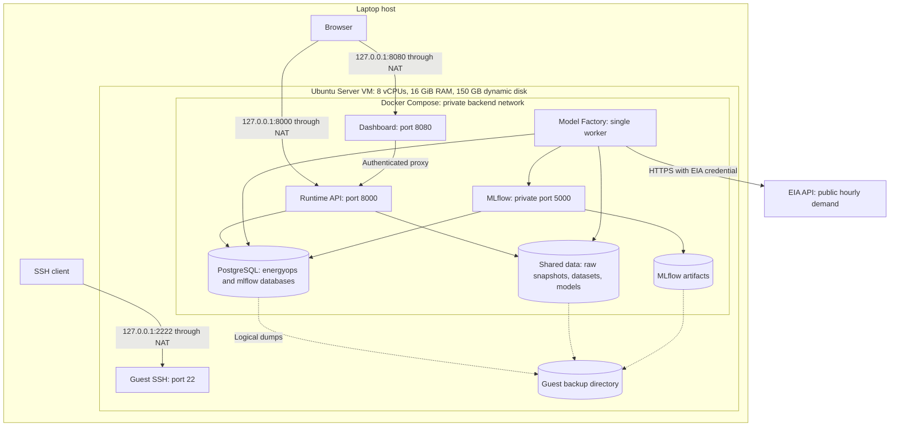

# Architecture

## Scope and implementation status

The Energy Operations Forecasting Hub runs its application workloads inside one Ubuntu Server VM. The laptop provides VirtualBox, a browser, SSH access, and a source-editing workspace. Data ingestion, preprocessing, training, evaluation, inference, databases, artifacts, and scheduling run inside the guest.

This document describes the current source implementation. Runtime, Model Factory, PostgreSQL, and MLflow were verified running. The dashboard source and deployment configuration exist; dashboard deployment and login verification remain outstanding. No model has been promoted to the serving champion. A reference baseline forecast is available for review.

The source is currently one shared codebase. Separate training and services Git repositories have not been created.

## Deployment topology

The dashboard node represents configured source, with verification still pending. The backend bridge permits outbound access for EIA ingestion; it is not an isolated Docker `internal` network. PostgreSQL and MLflow have no published guest ports.

## Two logical systems

| System | Responsibility | Source entry points | Execution |
|---|---|---|---|
| Training / Model Factory | Collect and validate demand; retain raw snapshots and revisions; create datasets; evaluate seasonal and tree models; register candidates | `app/factory.py`, `app/ingest.py`, `app/modeling.py`, `app/reproduce.py` | `model-factory` container |
| Services / Runtime | Authenticate API access; expose status, observations, forecasts, anomaly flags, job submission, approval and rollback; provide the dashboard | `app/api.py`, `dashboard/server.py`, `dashboard/index.html`, `dashboard/login.html` | `runtime` and `dashboard` containers |
| Shared infrastructure | Connection helpers, relational state, model files, experiment tracking, deployment and recovery | `app/db.py`, `compose.yaml`, `postgres/`, `mlflow/`, `scripts/` | PostgreSQL and MLflow containers plus guest storage |

Training and Runtime currently use the same application image. They share database tables, the `/data` mount, and some Python modules. The Runtime imports inference logic from `app/modeling.py`; separating repositories therefore requires a defined shared inference/artifact contract, rather than simply moving files.

A future split can use two repositories, `energy-ops-training` and `energy-ops-services`, with a versioned common package or documented artifact/schema contract. Those names are proposed; no remote repositories exist yet. Database migrations and Compose ownership must be assigned explicitly during that split.

## Service boundaries and resource limits

| Service | CPU limit | Memory limit | Persistent state | Access |
|---|---:|---:|---|---|
| Model Factory | 4 CPUs | 6 GiB | Shared `data/`; application database | Private backend; outbound EIA HTTPS |
| Runtime | 1.5 CPUs | 2 GiB | Shared `data/`; application database | Guest NAT address, port 8000 |
| PostgreSQL | 1.5 CPUs | 2 GiB | `postgres-data/` | Backend network only |
| MLflow | 1 CPU | 2 GiB | `mlflow-artifacts/`; `mlflow` database | Backend network only |
| Dashboard | 0.5 CPU | 512 MiB | In-memory login sessions | Guest NAT address, port 8080; verification pending |

Compose defines health checks, restart policies, and bounded container logs. Application containers drop Linux capabilities and run as an unprivileged user. The dashboard filesystem is configured read-only. Health checks indicate process/dependency readiness; they do not certify forecast quality or source freshness.

## Persistent storage and schemas

The guest deployment root is `/opt/energy-ops/deployment`.

| Location or table | Purpose |
|---|---|
| `data/raw/<sha>.json` | Immutable, sanitized EIA response snapshots |
| `data/quarantine/<sha>.json` | Invalid rows retained for review, when present |
| `data/datasets/` | Saved series, evaluation arrays and expected fold metrics |
| `data/models/` | Versioned tree artifacts and model metadata |
| `mlflow-artifacts/` | MLflow-served model/evaluation artifacts |
| `postgres-data/` | PostgreSQL physical database files |
| `secrets/` | Compose secret source files; excluded from source control |
| `settings` | Selected authority, collection/training timestamps, reference/candidate/champion pointers |
| `snapshots` | Source URL, retrieval timestamp, content SHA and safe request metadata |
| `observations` | Current validated hourly values, keyed by authority and UTC period |
| `revisions` | Initial values and later changes with snapshot provenance |
| `jobs` | Queue, job lifecycle and sanitized results/errors |
| `models` | Immutable model IDs, training dataset SHA and evaluation metadata |
| `forecast_runs` | Issue time, model ID, input dataset SHA and complete forecast payload |
| `audit` | Operator and worker actions |

PostgreSQL holds two databases: `energyops` for the application and `mlflow` for tracking and registry metadata. The initial implementation uses a shared database account; separate least-privilege roles are a future hardening task.

## Authentication and secrets

- Runtime protected endpoints require a Bearer token. `/healthz`, `/readyz`, and the API documentation are public within the local deployment boundary.
- The EIA key is read from a mounted secret by Model Factory. EIA's echoed request metadata is removed before raw responses are saved. Network exception strings are not recorded because they may contain key-bearing URLs.
- The dashboard is designed to verify the Ubuntu `energyops` password against a copied salted hash. It does not need the plaintext VM password. Its browser session cookie is HTTP-only, same-site strict, and expires after eight hours; sessions live only in container memory.
- The dashboard proxies authenticated requests to Runtime using a server-side API token. The browser does not receive that token. Modifying dashboard requests require a matching Origin.
- The dashboard password hash is a snapshot taken at deployment. Changing the guest account password requires refreshing that hash and restarting the dashboard.
- Local HTTP is restricted through host loopback forwarding. TLS and authenticated LAN access have not been configured. This configuration should not be exposed directly to a LAN.

Actual credential values do not belong in this documentation, Git, logs, or example payloads. Secret files mounted into authorized containers may have read permissions needed by different container UIDs; their containing guest directory remains root-only.

## Scheduling, job control and recovery

Model Factory polls its queue, performs hourly collection when due, and requests combined ingestion/training when the weekly training interval has elapsed. API job submission supports `ingest`, `train`, and `ingest_train`. It does not expose arbitrary shell commands.

One worker processes one job at a time. A PostgreSQL session advisory lock excludes a second worker at startup. A separate advisory lock protects schema initialization. On worker restart, jobs left `running` are marked `interrupted`, and a fresh job is needed to retry them. Failed jobs are recorded with sanitized errors and followed by a five-minute delay.

The worker lock depends on its database session. The current implementation does not continuously monitor that lock connection. After a PostgreSQL restart or session loss, restart Model Factory before allowing another worker instance. Automatic lock recovery and database-failure testing remain hardening work.

## Backup and restore

`scripts/backup.sh` checks for a running job, pauses Model Factory, Runtime and MLflow, dumps both databases, archives configuration/data/artifacts/secrets, writes SHA256 checksums, and restarts the paused services. Backup contents are sensitive and remain root-only under `/opt/energy-ops/backups`.

Both database dumps were restored into disposable databases. Restored model/data, MLflow artifact and secret files matched their SHA256 hashes. This verifies those recovery components; a complete replacement-VM disaster-recovery exercise and off-VM backup destination remain outstanding. See [restore instructions](../scripts/restore.md).

## Verified boundaries and remaining work

Verified: core service health, guest reboot persistence before application deployment, real EIA ingestion, chronological evaluation replay, reference forecasting, API authentication, startup exclusion of a duplicate worker, and database/file restoration. The application services also restarted successfully after the backup procedure.

Remaining: dashboard deployment/login validation, explicit model promotion, operational/live validation, a demonstrated rollback, representative user/training load tests, alert delivery, off-VM backups, and optional secure LAN access. No live accuracy, interval-coverage or user-capacity guarantee has been established.

## Related documents

- [Dataflow and model lifecycle](dataflow.md)
- [Deployment and operations](../README.md)
- [Compose configuration](../compose.yaml)
- [Original deployment specification](../../deployment-specification.md)
