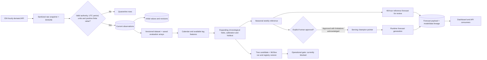
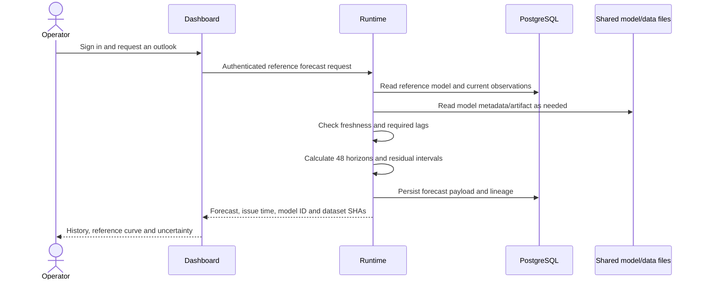
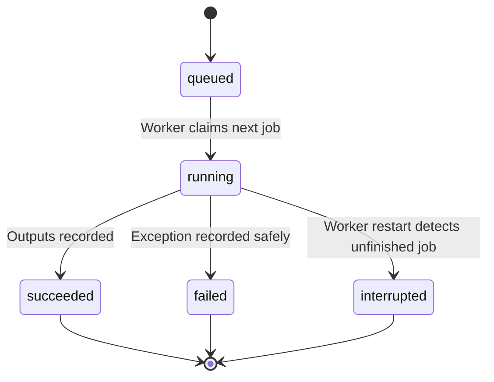

# Dataflow and model lifecycle

## End-to-end flow

Dashboard consumption is implemented in source but still requires deployment/login verification. No serving champion is currently selected.

## 1. Authority selection and collection

**Source:** EIA API v2 `electricity/rto/region-data/data/`, hourly frequency, demand type `D`. The API key comes from the guest secret mount, never from browser code.

1. Establish a UTC collection endpoint 24 hours behind the current hour.
2. Fetch a common 90-day window for CISO, ERCO and PJM.
3. Validate rows and compute coverage against the expected hourly periods.
4. Select the authority with the highest coverage, requiring at least 98%. Equal coverage is resolved by configured candidate order, currently CISO, ERCO, then PJM.
5. Collect approximately 400 days for the selected authority. Subsequent hourly collection revisits seven days to capture recent revisions.

The first run selected CISO. All three pilot candidates had 2,161 of 2,161 expected hours; CISO therefore won the configured tie-break. CISO's retained history contained 9,601 hours from September 10, 2025 at 01:00 UTC through October 15, 2026 at 01:00 UTC.

The first download intentionally stops 24 hours behind the current hour. This is a conservative reporting-delay policy, not evidence that every historical EIA value was available within 24 hours. Older revisions outside the seven-day lookback require a broader controlled refresh.

## 2. Raw snapshots, validation and revisions

Each paginated response becomes a sanitized JSON document containing returned data, API version and safe query parameters. EIA can echo the key in request metadata, so the original request echo is not retained. The sanitized bytes determine the SHA256 filename.

The `snapshots` table records the SHA, source endpoint, retrieval time, safe query, row count and file path. Retrieval times are observation-vintage evidence from this deployment onward; they do not reconstruct original historical publication times.

Validation rejects malformed periods/values, unexpected authority or demand type, unrecognized units, non-finite or non-positive demand, and periods too far in the future. Invalid rows are written to quarantine. This is structural validation; it is not a complete physical or operational plausibility model.

Valid rows are keyed by `(authority, period)`:

- A new point creates an observation and an initial revision record.
- A changed value creates a revision record and updates the current observation and snapshot pointer.
- An unchanged value is not duplicated.

EIA labels the source values as megawatthours for each hourly period. The forecast API presents the corresponding hourly-average MW equivalent and identifies that interpretation in model metadata.

## 3. Dataset identity and feature availability

The selected series is sorted by UTC period. A training dataset SHA is calculated from the period, value and source snapshot SHA for every retained point. Changing data values or their relevant provenance changes the dataset version.

For an issue time `I`, horizon `h` from 1 to 48, and target `T = I + h`, the reporting cutoff is `C = I - 24 hours`.

| Feature | Referenced time or value |
|---|---|
| Weekly seasonal lag | `T - 168 hours` |
| Two-week seasonal lag | `T - 336 hours` |
| Latest allowed observation | `C` |
| Previous-day observation at cutoff | `C - 24 hours` |
| Previous-week observation at cutoff | `C - 168 hours` |
| Known target calendar | UTC hour, weekday, month |
| Horizon | `h` |

Every referenced observation must be at or before `C` and present in the series. Missing required lags cause that historical sample to be excluded or a runtime forecast to be blocked. There is no interpolation across missing lags. A test verifies that replacing observations after the cutoff cannot change the features.

Historical issue times are sampled once per UTC day, with 48 target horizons each. The implementation does not currently issue historical samples at every hour or use weather forecasts.

## 4. Training, calibration and evaluation

The first implementation compares:

- **Seasonal weekly baseline:** use the demand from the target's matching hour one week earlier.
- **Tree candidate:** `HistGradientBoostingRegressor`, with fixed parameters and random seed, using the features above. There is no learned scaling or imputation fitted on the test data.

Three expanding-training evaluations use successive 14-day issue-time test windows. For each fold, let `E` be the last test issue time:

| Partition | Issue-time selection |
|---|---|
| Training | At or before `E - 30 days` |
| Residual calibration | After `E - 28 days`, at or before `E - 16 days` |
| Test | After `E - 14 days`, at or before `E` |

The gaps purge the 48-hour forecast target window at temporal boundaries. The final tree artifact is the model fitted for the final fold; it is not subsequently refitted on its calibration or holdout outcomes. Hyperparameters are fixed in source, rather than selected through a search over the holdout.

Metrics include MAE, WAPE, and separate MAE for horizons 1–24 and 25–48. Nominal 90% intervals use the 90th percentile of absolute calibration residuals separately for those two horizon groups. Their actual live coverage has not been established.

The historical values are the revisions available at collection time. Consequently, these are **retrospective revised-data evaluations**, not fully point-in-time historical backtests. The reporting cutoff and chronological splits address feature/label timing within the saved series; they cannot undo later source revisions. Live or publication-vintage validation remains required.

### First recorded holdout

Issue-time window: September 30–October 13, 2026 UTC; 672 forecast targets; 16,704 training samples.

| Metric | Weekly baseline | Tree candidate |
|---|---:|---:|
| MAE, MW equivalent | 6,016.24 | 3,588.43 |
| WAPE | 19.07% | 11.37% |
| MAE, horizons 1–24 | 5,653.25 | 3,341.22 |
| MAE, horizons 25–48 | 6,379.23 | 3,835.64 |

Relative MAE reduction was 40.35%. This is a measured result for that saved retrospective evaluation only. It does not establish live forecast quality, future improvements, or serving capacity.

Saved evaluation arrays and expected metrics allow `python -m app.reproduce <dataset_sha>` to replay all three folds inside a guest container without downloading new data. That replay passed.

## 5. Artifact registration and approval

Training saves versioned metadata, a tree artifact, the saved series/evaluation arrays, and expected fold metrics. The tree run's metrics and model/evaluation artifacts are also sent to private MLflow, with a registry version under `energy-demand`. These are custom joblib artifacts served by Runtime inference code, not a promise of an MLflow-native pyfunc serving interface.

The application tracks separate pointers:

| Pointer | Meaning |
|---|---|
| `reference_model` | Most recently generated seasonal baseline for review |
| `latest_candidate` | Most recently evaluated tree candidate |
| `champion` | Explicitly approved serving model; initially absent |
| `previous_champion` | Prior approved version retained for rollback |

The proposed metric gate checks at least 5% MAE improvement against the baseline and no greater than 5% regression in either horizon-group MAE on the final holdout. It is a proposal encoded in the current implementation, not a substitute for agreed operational acceptance thresholds. No deployed champion existed for the first comparison.

The tree's operational gate remains false because historical publication vintages and live validation are missing. Tree promotion is blocked even if the retrospective metric gate passes. Baseline promotion requires an authenticated operator request with explicit acknowledgement of the revised-history limitations. Promotion and rollback actions are audited. A rollback demonstration remains outstanding.

## 6. Forecast requests and lineage

`GET /v1/forecasts/reference` produces an explicitly labeled review forecast. `GET /v1/forecasts` returns a conflict until a champion is approved. Source data older than 72 hours blocks forecast generation; missing required lags can block it sooner.

Each successful response includes a forecast ID, authority, UTC issue time, latest observation, model ID, model-training dataset SHA, forecast-input dataset SHA, and 48 forecast points with nominal intervals. The full response is stored in `forecast_runs`. Requests therefore create forecast history even though their HTTP method is GET.

Anomaly flags compare recent observations against their same-hour weekly reference using a calibrated residual threshold. They are review flags, not confirmed faults, outages or causal diagnoses.

## 7. Control flow and failures

Hourly ingestion and weekly training are scheduled by the worker itself, inside the VM. An operator can also enqueue a controlled job through the API/dashboard. Only one worker owns the startup advisory lock, and that worker processes jobs sequentially.

EIA calls use timeouts and bounded retries. Failures record sanitized error types; arbitrary network exception text is suppressed. A source outage does not fabricate replacement observations. Current data/model status remains inspectable, and forecasts are blocked when freshness or lag requirements fail. Alert delivery to an external destination is not configured.

## References

- [Architecture and operational boundaries](architecture.md)
- [EIA API technical documentation](https://www.eia.gov/opendata/documentation.php)
- [MLflow tracking server documentation](https://mlflow.org/docs/latest/tracking/server/)
- Implementation: `app/ingest.py`, `app/modeling.py`, `app/factory.py`, `app/api.py`, `app/db.py`.
